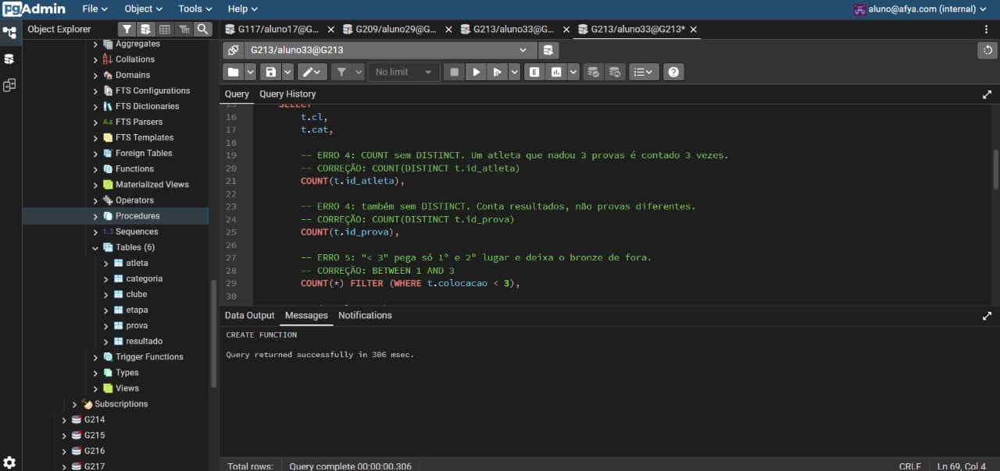
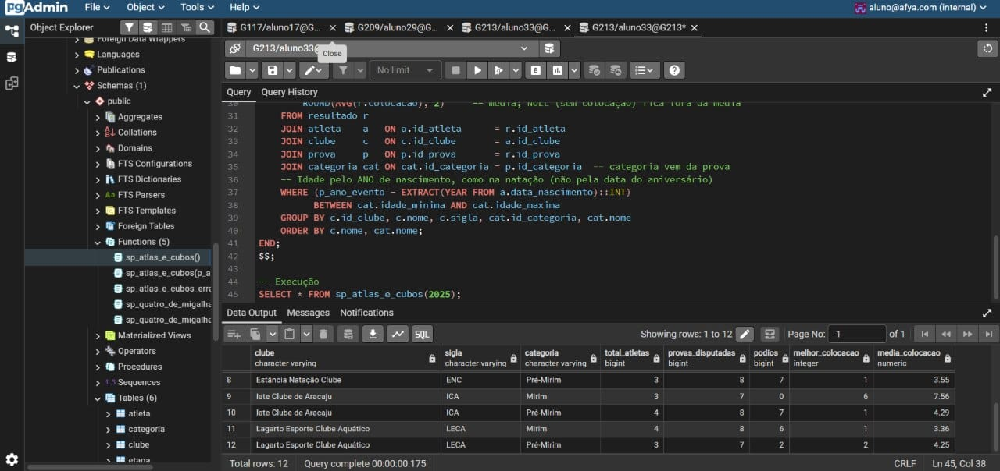

# Relatório: `sp_atlas_e_cubos` (desempenho por equipe)

**Atividade:** 29º Troféu Alexandre Pussieldi 2025 (FASE Aquática), Questão 2
**Aluna:** Ana Karoline Lopes Leite (Karol)
**Disciplina:** [preencher]
**Banco de dados:** PostgreSQL (pgAdmin)

---

## 1. Objetivo

Criar, com ajuda de uma IA, a procedure `sp_atlas_e_cubos` ("atletas e clubes"), que mostra as estatísticas de desempenho por clube, separadas por categoria (Pré-Mirim e Mirim), e corrigir os erros que a IA cometeu.

Regras do evento usadas na conferência:

- Pré-Mirim: até 9 anos.
- Mirim: 10 e 11 anos.
- A idade é calculada pelo **ano de nascimento** (ano do evento menos ano de nascimento), e não pela data exata do aniversário.

## 2. Modelo de dados utilizado

Tabelas do script de criação (CLUBE, CATEGORIA, ETAPA, ATLETA, PROVA, RESULTADO). As colunas relevantes para a procedure:

| Tabela | Colunas usadas |
|---|---|
| CLUBE | `id_clube`, `nome`, `sigla` |
| CATEGORIA | `id_categoria`, `nome`, `idade_minima`, `idade_maxima` |
| ATLETA | `id_atleta`, `nome`, `data_nascimento`, `id_clube` |
| PROVA | `id_prova`, `id_categoria` |
| RESULTADO | `id_resultado`, `id_prova`, `id_atleta`, `colocacao`, `situacao` |

## 3. Log da conversa com a IA

> O log completo (todos os prompts e respostas, desde o primeiro) segue em anexo, exportado da conversa. A tabela abaixo é o resumo da sequência.

| Etapa | Prompt da aluna | Resposta / resultado da IA |
|---|---|---|
| 1 | Lista de tarefas do trabalho, sem pedido específico | A IA perguntou o que fazer, qual era o papel da aluna e qual banco era usado |
| 2 | "quero que me ajude com minha parte karol" | Primeiro rascunho da procedure, em SQL Server (T-SQL), com esquema suposto |
| 3 | Detalhamento da atividade e do erro esperado nas faixas de idade | A IA listou os erros do próprio rascunho |
| 4 | Script `CREATE TABLE` do Josué | Reescrita em PostgreSQL, como `FUNCTION`, com os nomes reais |
| 5 | Como executar a consulta com os dados já inseridos | Passo a passo e consulta de contagem |
| 6 | Resultado da contagem (147 registros) e pedido do passo a passo da atividade | Passo a passo de criação, execução e validação |
| 7 | "pgAdmin" | Passo a passo específico do pgAdmin (Query Tool) |
| 8 | Pedido do código pronto para o pgAdmin | Três blocos de código mais uma versão sem função |
| 9 | Pedido de um código errado, com explicação | Versão errada com erros comentados |
| 10 | Pedido de mais tipos de código | Consultas alternativas (ranking, aproveitamento, melhor atleta) |
| 11 | Pedido de erros comentados dentro do código | Função `sp_atlas_e_cubos_errada` que roda sem erro, com comentários `ERRO` |
| 12 | Pedido dos comentários definitivos e do que enviar | Tabelas de erros e código final |

## 4. Erros reais cometidos pela IA

| # | O que a IA fez | Por que está errado | Como foi corrigido |
|---|---|---|---|
| 1 | Primeiro rascunho em **SQL Server (T-SQL)**: `CREATE OR ALTER PROCEDURE`, `SET NOCOUNT ON`, parâmetro `@ano_evento`, `EXEC`, `GO` | O banco do grupo é **PostgreSQL** (o script usa `SERIAL` e a execução é no pgAdmin). Esses comandos não existem lá | Reescrito em PL/pgSQL, com parâmetro `p_ano_evento` e `SELECT * FROM sp_atlas_e_cubos(2025)` |
| 2 | **Suposição de esquema**: usou a coluna `ano_nascimento` em ATLETA | O modelo real tem `data_nascimento` (DATE). A coluna usada não existe | Idade pelo ano: `p_ano_evento - EXTRACT(YEAR FROM data_nascimento)` |
| 3 | **Colunas inventadas** em CATEGORIA: `idade_min` e `idade_max` | Os nomes reais são `idade_minima` e `idade_maxima` | Nomes ajustados conforme o script de criação |
| 4 | Criou uma **procedure** que devolve uma tabela | No PostgreSQL, `PROCEDURE` não devolve conjunto de linhas, isso exige `FUNCTION ... RETURNS TABLE` | Implementada como função, mantendo o nome `sp_atlas_e_cubos` |
| 5 | Desconhecia as colunas `situacao`, `pontuacao`, `numero_serie` e `numero_raia` de RESULTADO | A consulta não considera a situação do atleta (por exemplo, desclassificado) | Registrado como ponto a decidir após conferir os dados inseridos |

**Sobre as faixas de idade:** no código real gerado na conversa, as faixas (Pré-Mirim até 9 e Mirim de 10 a 11) saíram corretas, porque a regra estava no enunciado. O erro típico dessas faixas está ilustrado na versão de demonstração (seção 5).

**Limitação assumida:** o filtro de idade no `WHERE` serve de conferência, mas, se um atleta estiver cadastrado na categoria errada, a linha some sem aviso. Por isso há a consulta de validação (seção 7).

## 5. Versão de demonstração com erros típicos

> Esta versão foi gerada **de propósito**, a pedido da aluna, para mostrar os erros que uma IA costuma cometer. Ela roda sem mensagem de erro, mas devolve números errados.

```sql
CREATE OR REPLACE FUNCTION sp_atlas_e_cubos_errada()
RETURNS TABLE (
    clube            VARCHAR,
    categoria        TEXT,
    total_atletas    BIGINT,
    provas           BIGINT,
    podios           BIGINT,
    melhor_colocacao INT,
    media_colocacao  NUMERIC
)
LANGUAGE plpgsql
AS $$
BEGIN
    RETURN QUERY
    SELECT
        t.cl,
        t.cat,

        -- ERRO 3: COUNT sem DISTINCT. Um atleta que nadou 3 provas é contado 3 vezes.
        -- CORREÇÃO: COUNT(DISTINCT t.id_atleta)
        COUNT(t.id_atleta),

        -- ERRO 3: também sem DISTINCT. Conta resultados, não provas diferentes.
        -- CORREÇÃO: COUNT(DISTINCT t.id_prova)
        COUNT(t.id_prova),

        -- ERRO 4: "< 3" pega só 1º e 2º lugar e deixa o bronze de fora.
        -- CORREÇÃO: BETWEEN 1 AND 3
        COUNT(*) FILTER (WHERE t.colocacao < 3),

        MIN(t.colocacao),

        -- ERRO 5: COALESCE transforma "sem colocação" (NULL) em 0, e o 0 derruba a média.
        -- CORREÇÃO: ROUND(AVG(t.colocacao), 2), pois o AVG já ignora NULL.
        AVG(COALESCE(t.colocacao, 0))
    FROM (
        SELECT
            c.nome AS cl,
            a.id_atleta,
            r.id_prova,
            r.colocacao,
            CASE
                -- ERRO 2: usa o ano atual (2026) em vez do ano do evento (2025).
                -- CORREÇÃO: 2025 - EXTRACT(YEAR FROM a.data_nascimento)
                --
                -- ERRO 1: faixa errada. Pré-Mirim vai até 9 anos, não até 8.
                -- CORREÇÃO: <= 9
                WHEN (2026 - EXTRACT(YEAR FROM a.data_nascimento)) <= 8
                    THEN 'Pré-Mirim'
                -- ERRO 1: faixa errada. Mirim é de 10 a 11 anos, não de 9 a 12.
                -- CORREÇÃO: BETWEEN 10 AND 11
                WHEN (2026 - EXTRACT(YEAR FROM a.data_nascimento)) BETWEEN 9 AND 12
                    THEN 'Mirim'
                -- ERRO 6: sem ELSE, quem cai fora das faixas fica com categoria NULL
                -- e aparece numa linha "sem categoria" em vez de ser tratado.
                -- CORREÇÃO: ler a categoria da tabela CATEGORIA (via PROVA.id_categoria)
                -- e não escrever as faixas fixas no código.
            END AS cat
        FROM resultado r
        JOIN atleta a ON a.id_atleta = r.id_atleta
        JOIN clube  c ON c.id_clube  = a.id_clube
        -- ERRO 7: não junta PROVA nem CATEGORIA. A categoria é deduzida só pela idade,
        -- sem usar a categoria real da prova que o atleta disputou.
        -- CORREÇÃO: JOIN prova p ON ... JOIN categoria cat ON cat.id_categoria = p.id_categoria
    ) t
    GROUP BY t.cl, t.cat
    ORDER BY t.cl, t.cat;
END;
$$;
```

| # | Erro (demonstração) | Correção |
|---|---|---|
| 1 | Faixas inventadas (Pré-Mirim até 8, Mirim 9 a 12) | Até 9 e 10 a 11, lendo de `categoria` |
| 2 | Idade calculada com o ano 2026 em vez de 2025 | Usar o parâmetro `p_ano_evento` |
| 3 | `COUNT` sem `DISTINCT` | `COUNT(DISTINCT ...)` |
| 4 | Pódio com `< 3` | `BETWEEN 1 AND 3` |
| 5 | `COALESCE(colocacao, 0)` derruba a média | Deixar o `NULL` fora da média |
| 6 | Sem `ELSE`, atleta fora das faixas vira categoria `NULL` | Usar a categoria da tabela CATEGORIA |
| 7 | Não junta PROVA nem CATEGORIA | `JOIN prova` e `JOIN categoria` |

## 6. Código final

```sql
-- =====================================================================
-- sp_atlas_e_cubos (atletas e clubes): desempenho por clube e categoria
-- SGBD: PostgreSQL. Implementada como FUNCTION, pois no PostgreSQL só
-- funções devolvem tabela de resultado.
-- p_ano_evento: ano da competição (2025). Idade = ano do evento - ano de nascimento.
-- =====================================================================
CREATE OR REPLACE FUNCTION sp_atlas_e_cubos(p_ano_evento INT DEFAULT 2025)
RETURNS TABLE (
    clube              VARCHAR,
    sigla              VARCHAR,
    categoria          VARCHAR,
    total_atletas      BIGINT,
    provas_disputadas  BIGINT,
    podios             BIGINT,
    melhor_colocacao   INT,
    media_colocacao    NUMERIC
)
LANGUAGE plpgsql
AS $$
BEGIN
    RETURN QUERY
    SELECT
        c.nome,
        c.sigla,
        cat.nome,
        COUNT(DISTINCT a.id_atleta),   -- DISTINCT: um atleta com várias provas conta uma vez
        COUNT(DISTINCT r.id_prova),    -- DISTINCT: provas diferentes, não linhas de resultado
        COUNT(*) FILTER (WHERE r.colocacao BETWEEN 1 AND 3),  -- pódio: 1º, 2º e 3º
        MIN(r.colocacao),              -- melhor colocação (NULL é ignorado)
        ROUND(AVG(r.colocacao), 2)     -- média; NULL (sem colocação) fica fora da média
    FROM resultado r
    JOIN atleta    a   ON a.id_atleta      = r.id_atleta
    JOIN clube     c   ON c.id_clube       = a.id_clube
    JOIN prova     p   ON p.id_prova       = r.id_prova
    JOIN categoria cat ON cat.id_categoria = p.id_categoria  -- categoria vem da prova
    -- Idade pelo ANO de nascimento, como na natação (não pela data do aniversário)
    WHERE (p_ano_evento - EXTRACT(YEAR FROM a.data_nascimento)::INT)
          BETWEEN cat.idade_minima AND cat.idade_maxima
    GROUP BY c.id_clube, c.nome, c.sigla, cat.id_categoria, cat.nome
    ORDER BY c.nome, cat.nome;
END;
$$;

-- Execução
SELECT * FROM sp_atlas_e_cubos(2025);
```

## 7. Consulta de validação das idades

Lista atletas cuja idade (pelo ano de nascimento) não bate com a categoria da prova. Se voltar vazia, os dados estão consistentes.

```sql
SELECT a.nome, cat.nome AS categoria,
       2025 - EXTRACT(YEAR FROM a.data_nascimento)::INT AS idade
FROM resultado r
JOIN atleta a      ON a.id_atleta      = r.id_atleta
JOIN prova p       ON p.id_prova       = r.id_prova
JOIN categoria cat ON cat.id_categoria = p.id_categoria
WHERE (2025 - EXTRACT(YEAR FROM a.data_nascimento)::INT)
      NOT BETWEEN cat.idade_minima AND cat.idade_maxima;
```

## 8. Prints da execução

### 8.1 Criação da versão de demonstração com erros

`CREATE OR REPLACE FUNCTION sp_atlas_e_cubos_errada()` executado no pgAdmin. A função é criada sem erro de sintaxe ("CREATE FUNCTION / Query returned successfully"), o que mostra que os erros da IA são de **lógica** e não aparecem na compilação.



### 8.2 Resultado da versão final

`SELECT * FROM sp_atlas_e_cubos(2025);`: 12 linhas, uma por clube e categoria (6 clubes × 2 categorias), com atletas, provas disputadas, pódios, melhor colocação e média de colocação.



