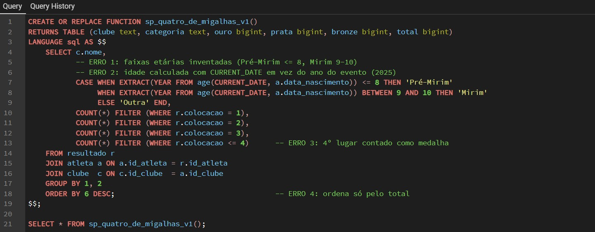
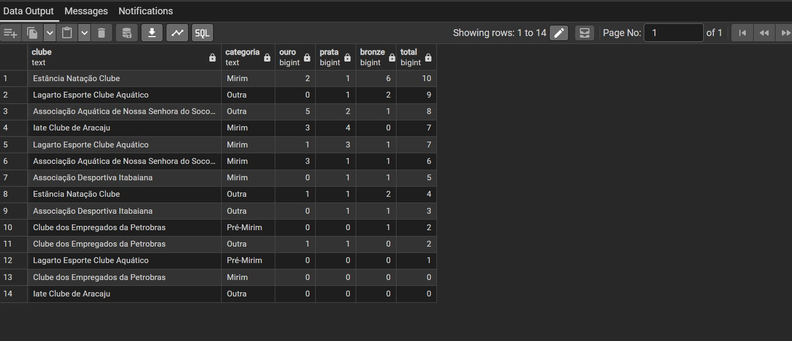

# sp_quatro_de_migalhas: Quadro de Medalhas
**29º Troféu Alexandre Pussieldi 2025 (Pré-Mirim e Mirim)** · Responsável: Théo

---

## ETAPA 1: Interpretação do nome da consulta
O nome *quatro de migalhas* é propositalmente não convencional. No contexto do campeonato de natação, ele representa o **quadro de medalhas**: ranking dos clubes por quantidade de ouros, pratas e bronzes, separado por categoria (Pré-Mirim e Mirim).

---

## ETAPA 2: Prompt inicial e resposta da IA

**Prompt 1 (enviado à IA):**
> Crie uma procedure SQL chamada sp_quatro_de_migalhas que retorne o quadro de medalhas de um campeonato de natação por clube e por categoria (Pré-Mirim e Mirim), com ouro, prata, bronze e total.

**Resposta da IA (versão 1, sem correção):**
```sql
CREATE OR REPLACE FUNCTION sp_quatro_de_migalhas_v1()
RETURNS TABLE (clube text, categoria text, ouro bigint, prata bigint, bronze bigint, total bigint)
LANGUAGE sql AS $$
    SELECT c.nome,
           CASE WHEN EXTRACT(YEAR FROM age(CURRENT_DATE, a.data_nascimento)) <= 8 THEN 'Pré-Mirim'
                WHEN EXTRACT(YEAR FROM age(CURRENT_DATE, a.data_nascimento)) BETWEEN 9 AND 10 THEN 'Mirim'
                ELSE 'Outra' END,
           COUNT(*) FILTER (WHERE r.colocacao = 1),
           COUNT(*) FILTER (WHERE r.colocacao = 2),
           COUNT(*) FILTER (WHERE r.colocacao = 3),
           COUNT(*) FILTER (WHERE r.colocacao <= 4)
    FROM resultado r
    JOIN atleta a ON a.id_atleta = r.id_atleta
    JOIN clube  c ON c.id_clube  = a.id_clube
    GROUP BY 1, 2
    ORDER BY 6 DESC;
$$;
```

---

## ETAPA 3: Execução da versão 1 e análise dos erros

Consulta executada: `SELECT * FROM sp_quatro_de_migalhas_v1();`

**Código da versão 1 no pgAdmin, com os erros comentados:**



**Resultado da versão 1:**



O print mostra os efeitos das alucinações:
- A consulta devolve 14 linhas e várias são da categoria **"Outra"**, que não existe no evento. Como a idade foi calculada com `CURRENT_DATE` (2026), atletas Mirim passaram de 11 anos e caíram fora das faixas.
- Quase não aparece **Pré-Mirim**, porque a faixa "até 8 anos" deixa de fora quem tem 9.
- O **total** é maior que ouro + prata + bronze (ex.: Lagarto/"Outra" com 0 + 1 + 2 = 3 medalhas e total 9), porque o 4º lugar foi contado.
- A ordem segue o total, e não o número de ouros: a Associação Aquática de N. Sra. do Socorro, com 5 ouros, aparece abaixo de clubes com menos ouros.

**Comentários do Théo sobre os erros da IA (alucinações):**

| # | Erro da IA | Por que está errado | Correção |
|---|-----------|---------------------|----------|
| 1 | **Faixas etárias inventadas:** Pré-Mirim ≤ 8 e Mirim 9–10 | O site oficial da FASE Aquática define **Pré-Mirim: até 9 anos; Mirim: 10–11 anos**. No print, os atletas de 9 anos viraram "Mirim" e quase não sobrou Pré-Mirim | As faixas ficam na tabela `CATEGORIA`, sem números fixos no código |
| 2 | **Idade calculada com `CURRENT_DATE`** | A idade muda conforme o dia em que a consulta roda; a competição foi em 2025 | A categoria passa a vir da **prova** (`PROVA.id_categoria`), a categoria oficial em que o atleta competiu |
| 3 | **`colocacao <= 4` no total** | 4º lugar não recebe medalha. No print, o total é maior que ouro + prata + bronze | Filtro `colocacao IN (1,2,3)` |
| 4 | **`ORDER BY total DESC`** | Quadro de medalhas ordena por ouro, depois prata, depois bronze | `RANK()` por ouro, prata e bronze |
| 5 | **Categoria "Outra"** | Só existem Pré-Mirim e Mirim neste evento | JOIN com `categoria` via `prova`: a categoria "Outra" deixa de existir |
| 6 | Sem filtro por categoria e sem coluna de posição | A organização precisa do quadro por categoria | Parâmetro opcional `p_categoria` e coluna `posicao` |

---

## ETAPA 4: Prompt de correção

**Prompt 2 (enviado à IA):**
> A idade está errada: Pré-Mirim é até 9 anos e Mirim de 10 a 11, conforme o site da FASE Aquática. Não use a data atual: a categoria já está em PROVA.id_categoria, use-a. Conte só colocação 1, 2 e 3, ordene por ouro > prata > bronze, rankeie por categoria e aceite um parâmetro opcional de categoria.

---

## ETAPA 5: Código final (comentado)

```sql
-- =====================================================================
-- sp_quatro_de_migalhas  ->  QUADRO DE MEDALHAS do 29º Troféu Alexandre Pussieldi 2025
-- ("quatro de migalhas" = o quadro/painel de medalhas)
--
-- Parâmetro:
--   p_categoria: 'Pré-Mirim', 'Mirim' ou NULL (= todas as categorias)
-- Retorno: uma linha por clube e categoria, com posição, ouro, prata, bronze e total.
--
-- Regras de negócio:
--  * A categoria do resultado é a da PROVA (PROVA.id_categoria), que é a categoria oficial
--    em que o atleta competiu. Faixas: Pré-Mirim até 9 anos; Mirim 10 a 11 anos
--    (guardadas em CATEGORIA.idade_minima/idade_maxima, sem números fixos no código).
--  * Medalha = colocação 1 (ouro), 2 (prata) ou 3 (bronze). 4º lugar em diante NÃO conta.
--  * Desclassificados/ausentes têm colocacao NULL e ficam de fora automaticamente.
--  * Ordenação olímpica: mais ouros; empate -> mais pratas; empate -> mais bronzes.
--    RANK() mantém empate total na mesma posição.
-- =====================================================================
CREATE OR REPLACE FUNCTION sp_quatro_de_migalhas(p_categoria text DEFAULT NULL)
RETURNS TABLE (
    posicao   bigint,
    clube     text,
    categoria text,
    ouro      bigint,
    prata     bigint,
    bronze    bigint,
    total     bigint
)
LANGUAGE sql STABLE AS $$
    WITH medalhas AS (
        SELECT cl.nome AS clube, ct.nome AS categoria, ct.id_categoria, r.colocacao
        FROM resultado r
        JOIN prova     p  ON p.id_prova     = r.id_prova
        JOIN categoria ct ON ct.id_categoria = p.id_categoria
        JOIN atleta    a  ON a.id_atleta    = r.id_atleta
        JOIN clube     cl ON cl.id_clube    = a.id_clube
        WHERE r.colocacao IN (1, 2, 3)                          -- só pódio
          AND (p_categoria IS NULL OR ct.nome = p_categoria)
    ),
    agregado AS (
        SELECT clube, categoria, id_categoria,
               COUNT(*) FILTER (WHERE colocacao = 1) AS ouro,
               COUNT(*) FILTER (WHERE colocacao = 2) AS prata,
               COUNT(*) FILTER (WHERE colocacao = 3) AS bronze,
               COUNT(*)                              AS total
        FROM medalhas
        GROUP BY clube, categoria, id_categoria
    )
    SELECT RANK() OVER (PARTITION BY id_categoria ORDER BY ouro DESC, prata DESC, bronze DESC),
           clube, categoria, ouro, prata, bronze, total
    FROM agregado
    ORDER BY id_categoria, 1, clube;
$$;
```

---

## ETAPA 6: Execução da versão final (prints)

**6.1** `SELECT * FROM sp_quatro_de_migalhas();`
> **[COLAR AQUI O PRINT]**
> Legenda: quadro completo, com as duas categorias, ordenado por ouro, prata e bronze.

**6.2** `SELECT * FROM sp_quatro_de_migalhas('Mirim');`
> **[COLAR AQUI O PRINT]**
> Legenda: filtro pela categoria Mirim.

**6.3** `SELECT * FROM sp_quatro_de_migalhas('Pré-Mirim');`
> **[COLAR AQUI O PRINT]**
> Legenda: filtro pela categoria Pré-Mirim.

**Resultado esperado com a carga da Thallis (6.1):**
```
 posicao |               clube               | categoria | ouro | prata | bronze | total
---------+-----------------------------------+-----------+------+-------+--------+-------
       1 | Iate Clube de Aracaju / Agitação  | Pré-Mirim |    4 |     2 |      2 |     8
       2 | Equipe Nad'Art de Natação         | Pré-Mirim |    3 |     3 |      2 |     8
       3 | Aquasport Centro Aquático         | Pré-Mirim |    1 |     2 |      1 |     4
       4 | BNB Clube de Fortaleza            | Pré-Mirim |    0 |     1 |      2 |     3
       5 | Clube de Regatas Brasil           | Pré-Mirim |    0 |     1 |      0 |     1
       1 | Equipe Nad'Art de Natação         | Mirim     |    4 |     3 |      1 |     8
       2 | BNB Clube de Fortaleza            | Mirim     |    3 |     1 |      2 |     6
       3 | Clube de Regatas Brasil           | Mirim     |    1 |     1 |      1 |     3
       4 | Aquasport Centro Aquático         | Mirim     |    0 |     2 |      0 |     2
       5 | Iate Clube de Aracaju / Agitação  | Mirim     |    0 |     1 |      3 |     4
       6 | Clube dos Empregados da Petrobras | Mirim     |    0 |     0 |      1 |     1
```

**Validação:**
- A carga tem 16 ouros, 17 pratas (o empate da Prova 14 gera duas pratas) e 15 bronzes = 48 medalhas; o quadro soma 24 (Pré-Mirim) + 24 (Mirim) = 48.
- Desclassificados e não comparecimentos têm colocação nula e ficam fora do quadro.
- A auditoria de integridade da Thallis (atleta fora da faixa etária ou sexo divergente) retorna 0 linhas.

---

## ETAPA 7: Justificativa técnica
- **Categoria vinda da prova:** o quadro reflete a categoria em que o atleta realmente competiu, sem recalcular idade, e evita o erro de idade pela data atual.
- **Faixas etárias em tabela:** a regra (Pré-Mirim até 9; Mirim 10–11) fica em `CATEGORIA`, e uma mudança de regra exige alterar só um registro.
- **Medalha derivada da colocação:** sem coluna redundante; só 1º, 2º e 3º contam.
- **`RANK()`:** segue o critério olímpico (ouro, prata, bronze) e mantém empates totais na mesma posição.
- **Parâmetro opcional:** a mesma rotina serve ao quadro geral e ao quadro por categoria.
